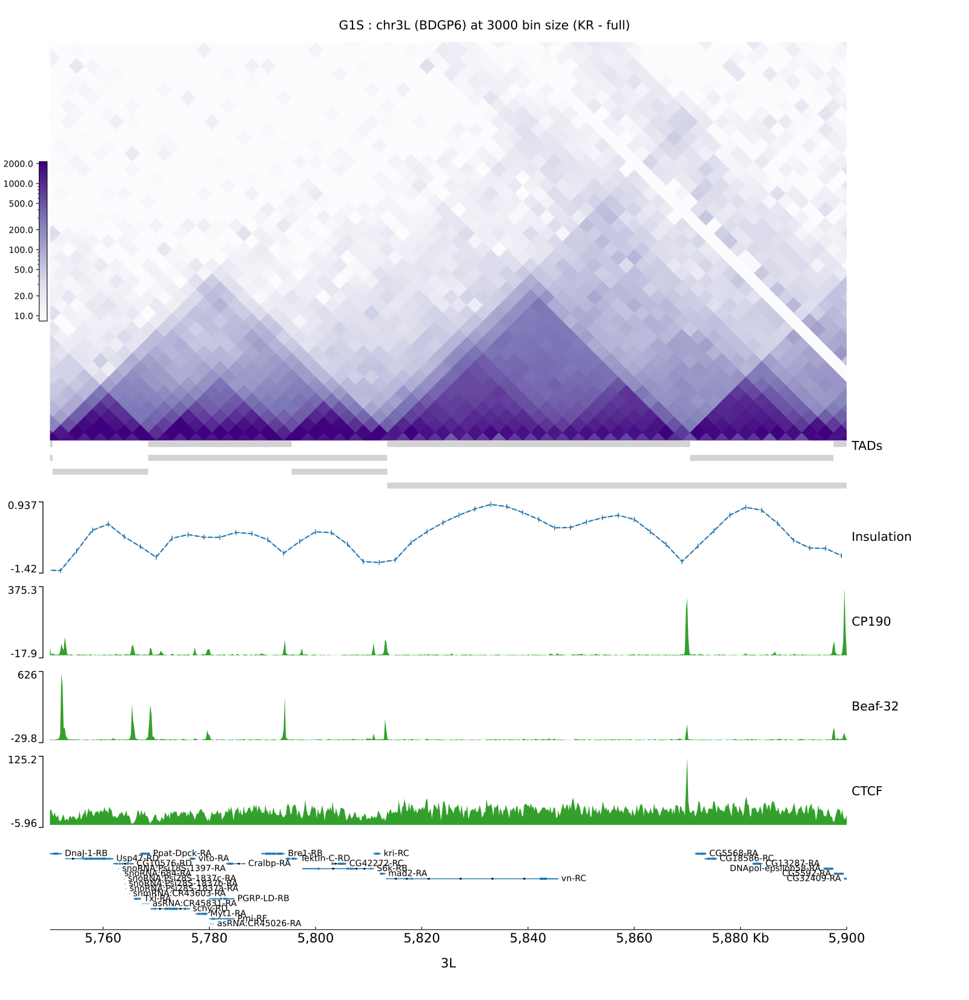
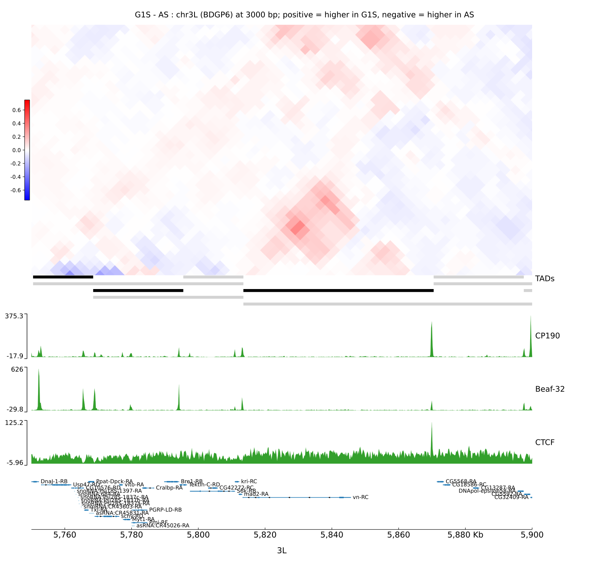
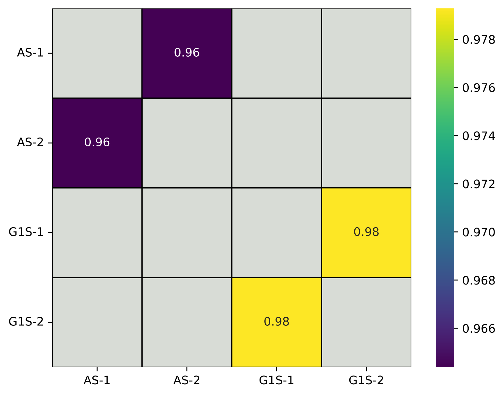

# HiCFlow

HiCFlow is a Nextflow DSL2 workflow for processing paired-end Hi-C and Capture Hi-C data into normalised contact matrices, TAD annotations, sample comparisons, publication-ready plots, viewpoints, and quality-control reports.

The Nextflow implementation supports the non-allele-specific diploid workflow.

## Features

HiCFlow includes:

- Raw and trimmed FastQC
- Paired-end Cutadapt trimming
- HiCUP read truncation
- Bowtie2 alignment
- Duplicate removal and alignment filtering
- HiCExplorer matrix construction
- Replicate merging
- Multiple output resolutions
- Count normalisation and KR correction
- Observed/expected transformation
- HiCExplorer TAD calling
- OnTAD nested-domain calling
- HiCcompare joint normalisation
- Direction-explicit matrix subtraction
- Median-filtered comparison matrices
- Differential TAD scoring
- Standard and comparison pyGenomeTracks plots
- Standard and HiCcompare-adjusted viewpoints
- HiCRep reproducibility analysis
- Matrix-coverage QC
- Insert-size and orientation QC
- MultiQC reporting
- Optional Cscore compartment analysis

The workflow deliberately excludes:

- FastQ Screen
- Variant calling
- Haplotype assembly
- SNPsplit
- Allele-specific matrices
- ASHiC

## Requirements

The only runtime requirements are:

- Git
- Docker Desktop or Docker Engine
- At least 8 GB of memory available to Docker
- An `amd64`-compatible Docker runtime

The Docker image contains Nextflow, Java, Python, R, HiCExplorer, HiCUP, Bowtie2, Cutadapt, FastQC, HiCcompare, HiCRep, OnTAD, pyGenomeTracks, MultiQC, and the other workflow dependencies.

The image is built for `linux/amd64`. On Apple Silicon, Docker Desktop runs it using emulation.

## Installation

Clone the repository:

```bash
git clone https://github.com/StephenRicher/HiCFlow.git
cd HiCFlow
```

Build the self-contained image:

```bash
docker build \
    --platform linux/amd64 \
    --tag hicflow-nextflow:latest \
    .
```

## Configuration

The workflow is configured through `nextflow.config`.

The bundled example uses:

```text
example/config/samples.tsv
example/config/regions.bed
example/config/plot_coordinates.bed
example/config/viewpoints.bed
example/config/vlines.bed
example/genome/BDGP6.28.fa.gz
```

### Sample sheet

The sample sheet is a tab-separated file containing:

```text
experiment	cell_type	group	rep	R1	R2
```

For example:

```text
A	S2Rplus	G1S	1	../data/G1S-1-R1.fastq.gz	../data/G1S-1-R2.fastq.gz
A	S2Rplus	G1S	2	../data/G1S-2-R1.fastq.gz	../data/G1S-2-R2.fastq.gz
A	S2Rplus	AS	1	../data/AS-1-R1.fastq.gz	../data/AS-1-R2.fastq.gz
A	S2Rplus	AS	2	../data/AS-2-R1.fastq.gz	../data/AS-2-R2.fastq.gz
```

Each row describes one paired-end replicate.

Relative FASTQ paths are resolved relative to the sample sheet.

### Analysis regions

The regions file is a four-column BED file:

```text
chromosome	start	end	name
```

For example:

```text
3L	5500000	6000000	chr3L
```

Region names must be unique and must not contain `-`, `.`, or `/`.

`regions.bed` defines the intervals extracted and analysed.

### Plot coordinates

`plot_coordinates.bed` independently defines the genomic windows rendered in the final plots. It uses the same four-column format:

```text
3L	5500000	6000000	chr3L
3L	5750000	5900000	chr3L
```

The complete coordinates are incorporated into output filenames, allowing multiple plotting windows to share the same region name without overwriting one another.

### Viewpoints

`viewpoints.bed` defines viewpoint intervals:

```text
3L	5740000	5750000	chr3L
3L	5870000	5890000	chr3L
```

The workflow pads each viewpoint using `params.plot.viewpointRange` while keeping the resulting window inside the associated analysis region.

### Genome references

A reference FASTA must be configured for every `cell_type` present in the sample sheet:

```groovy
genome = [
    S2Rplus: 'example/genome/BDGP6.28.fa.gz'
]
```

HiCFlow prepares the compressed FASTA, FASTA index, chromosome sizes, restriction-site BED, and Bowtie2 index automatically.

### Matrix resolutions

The base and output resolutions are configured as:

```groovy
resolution = [
    base: 1000,
    bins: [3000]
]
```

Multiple output resolutions may be requested:

```groovy
resolution = [
    base: 1000,
    bins: [3000, 5000, 10000]
]
```

Every output resolution must be exactly divisible by the base resolution.

### Restriction enzyme

The example uses DpnII:

```groovy
hicup = [
    restrictionSequence: '^GATC',
    nofill             : false
]
```

### Matrix comparison direction

Subtraction matrices use direction-explicit names:

```text
MINUEND-minus-SUBTRAHEND
```

For example:

```text
G1S-minus-AS
```

means:

```text
G1S - AS
```

Therefore:

- Positive values indicate higher interactions in `G1S`.
- Negative values indicate higher interactions in `AS`.

Each comparison includes a metadata file recording the operation and its interpretation:

```text
results/matrix/compare/<region>/<resolution>/*-subtraction.tsv
```

For example:*
```text
minuend	G1S
subtrahend	AS*operation	G1S - AS
positive_values*Higher in G1S
negative_values	High*r in AS
```

### Optional compartm*nt scoring

Cscore support is cont*olled by:

```groovy
hic = [
    compartmentScore: false
]
```

Cscor* is disabled for the bundled examp*e because it analyses a 500 kb Cap*ure Hi-C interval. Compartment ana*ysis is intended for substantially*larger, usually chromosome-scale r*gions.

## Running the example

Run the workflow from the repository root:

```bash
docker run --rm \
    --platform linux/amd64 \
    --volume "$PWD:$PWD" \
    --workdir "$PWD" \
    hicflow-nextflow:latest \
    run /opt/hicflow/main.nf \
    -profile container \
    --outdir "$PWD/results"
```

The workflow reads `nextflow.config` and processes the bundled example dataset.

## Resuming an interrupted run

Nextflow caches completed tasks under `work/`.

Resume the workflow without repeating successful processes:

```bash
docker run --rm \
    --platform linux/amd64 \
    --volume "$PWD:$PWD" \
    --workdir "$PWD" \
    hicflow-nextflow:latest \
    run /opt/hicflow/main.nf \
    -profile container \
    --outdir "$PWD/results" \
    -resume
```

Do not delete `work/` if you intend to resume.

## Running a custom analysis

Create a Nextflow configuration containing dataset-specific paths and parameter overrides.

For example:

```groovy
params {
    samplesheet = '/analysis/config/samples.tsv'
    regions = '/analysis/config/regions.bed'
    outdir = '/analysis/results'

    genome = [
        CellTypeA: '/analysis/genome/reference.fa.gz'
    ]

    genomeBuild = 'GRCh38'

    resolution = [
        base: 5000,
        bins: [10000, 25000]
    ]

    plot = [
        coordinates      : '/analysis/config/plot_coordinates.bed',
        viewpoints       : '/analysis/config/viewpoints.bed',
        vlines           : '/analysis/config/vlines.bed',
        viewpointRange   : 150000,
        plotRep          : true,
        distanceNorm     : false,
        colourmap        : 'Purples',
        filetype         : 'svg',
        dpi              : 600,
        geneLabelFontSize: 10,
        maxLabels        : 60,
        coverageFontSize : 12
    ]

    qc = [
        runHiCRep   : true,
        hicRepBin   : 25000,
        coverageBins: 10000,
        samplePairs : 100000
    ]
}
```

Run with the additional configuration:

```bash
docker run --rm \
    --platform linux/amd64 \
    --volume "/analysis:/analysis" \
    --workdir "/analysis" \
    hicflow-nextflow:latest \
    run /opt/hicflow/main.nf \
    -profile container \
    -c "/analysis/analysis.config" \
    --outdir "/analysis/results"
```

Use absolute paths in external configuration files so that host and container paths are unambiguous.

Every referenced path must be available inside the container through a Docker volume mount.

## Useful runtime options

Override the output directory:

```bash
--outdir /analysis/results
```

Override the sample sheet:

```bash
--samplesheet /analysis/config/samples.tsv
```

Override the regions file:

```bash
--regions /analysis/config/regions.bed
```

Use a separate Nextflow work directory:

```bash
-work-dir /analysis/work
```

A complete custom invocation might therefore be:

```bash
docker run --rm \
    --platform linux/amd64 \
    --volume "/analysis:/analysis" \
    --workdir "/analysis" \
    hicflow-nextflow:latest \
    run /opt/hicflow/main.nf \
    -profile container \
    -c "/analysis/analysis.config" \
    -work-dir "/analysis/work" \
    --samplesheet "/analysis/config/samples.tsv" \
    --regions "/analysis/config/regions.bed" \
    --outdir "/analysis/results" \
    -resume
```

## Validating the example

After the example workflow completes, run:

```bash
tests/validate_example.sh results
```

A successful run prints:

```text
HiCFlow example validation passed
```

The validation checks:

- Filtered BAM files
- Raw and KR-corrected matrices
- HiCExplorer insulation outputs
- OnTAD domains
- Direction-explicit HiCcompare subtraction matrices
- Differential TAD annotations
- Standard pyGenomeTracks plots
- Subtraction plots
- Standard viewpoints
- HiCcompare-adjusted viewpoints
- HiCRep results
- Matrix-coverage plots
- Insert-size QC
- MultiQC report
- Subtraction-direction metadata

## Output structure

Major outputs are organised as:

```text
results/
├── annotation/
├── bam/
├── fastq/
├── genome/
├── logs/
├── matrix/
│   ├── base/
│   ├── regions/
│   └── compare/
├── pipeline_info/
├── plots/
├── qc/
├── tads/
└── viewpoints/
```

### Contact matrices

Base-resolution whole-reference matrices:

```text
results/matrix/base/raw/
```

Base-resolution matrices restricted to configured analysis regions:

```text
results/matrix/regions/base/raw/
```

Raw and count-normalised matrices for replicates and merged groups:

```text
results/matrix/regions/<resolution>/raw/
```

KR-corrected matrices:

```text
results/matrix/regions/<resolution>/KR/
```

Observed/expected matrices:

```text
results/matrix/regions/<resolution>/KR/obs_exp/
```

### Matrix comparisons

Comparison outputs are written to:

```text
results/matrix/compare/<region>/<resolution>/
```

This directory contains:

- HiCcompare-adjusted matrices
- Observed/expected adjusted matrices
- Unfiltered subtraction matrices
- Median-filtered subtraction matrices
- Subtraction-direction metadata

Subtraction outputs use direction-explicit names such as:

```text
G1S-minus-AS-chr3L-3000-LOESSdiff-medianFilter-full.h5
```

### TAD outputs

TAD outputs are written to:

```text
results/tads/<region>/<resolution>/
```

This directory contains:

- HiCExplorer TAD boundaries
- HiCExplorer domains
- Insulation-score bedGraphs
- Z-score matrices
- OnTAD domain calls

Differential TAD annotations are written to:

```text
results/tads/<region>/<resolution>/differential/
```

### Standard plots

Standard pyGenomeTracks plots are written to:

```text
results/plots/<region>/<resolution>/pyGenomeTracks/
```

These plots combine:

- KR-corrected Hi-C matrices
- HiCExplorer insulation scores
- OnTAD domains
- Gene annotations
- Configured BigWig tracks
- Optional vertical lines

### Subtraction plots

Median-filtered comparison plots are written to:

```text
results/plots/<region>/<resolution>/subtraction/medianFilter/
```

Comparison plot titles explicitly state the subtraction direction and sign interpretation.

For example:

```text
G1S - AS
positive = higher in G1S
negative = higher in AS
```

### Viewpoints

Standard viewpoint plots are written to:

```text
results/plots/<region>/<resolution>/viewpoints/
```

Their bedGraph data are written to:

```text
results/viewpoints/<region>/<resolution>/
```

HiCcompare-adjusted viewpoint plots are written to:

```text
results/plots/<region>/<resolution>/viewpoints/hiccompare/
```

Their bedGraph data are written to:

```text
results/viewpoints/<region>/<resolution>/hiccompare/
```

### HiCRep

Per-comparison HiCRep scores are written to:

```text
results/qc/hicrep/data/
```

The combined reproducibility heatmap is written to:

```text
results/qc/hicrep/<region>-<resolution>-hicrep-full.svg
```

### Matrix coverage

Coverage plots are written to:

```text
results/qc/matrix_coverage/<region>/
```

Each plot compares contact coverage across the configured matrix resolutions for one replicate or merged group.

### Insert-size QC

Processed QC data are written to:

```text
results/qc/filter_qc/data/
```

The combined insert-size and read-orientation plot is written to:

```text
results/qc/filter_qc/insertSizeFrequency.svg
```

### MultiQC

The combined MultiQC report is written to:

```text
results/qc/multiqc/multiqc_report.html
```

Supporting report data are written to:

```text
results/qc/multiqc/multiqc_report_data/
```

FastQ Screen is deliberately excluded.

### Pipeline information

Nextflow execution metadata are written to:

```text
results/pipeline_info/
```

This includes:

```text
execution_report.html
execution_timeline.html
execution_trace.txt
pipeline_dag.html
```

## Development

Build the development image:

```bash
docker build \
    --platform linux/amd64 \
    --tag hicflow-nextflow:development \
    .
```

Run the current workflow and reuse cached tasks:

```bash
docker run --rm \
    --platform linux/amd64 \
    --volume "$PWD:$PWD" \
    --workdir "$PWD" \
    hicflow-nextflow:development \
    run /opt/hicflow/main.nf \
    -profile container \
    --outdir "$PWD/results" \
    -resume
```

Run the example validation:

```bash
tests/validate_example.sh results
```

Perform a clean validation run:

```bash
rm -rf work-clean results-clean

docker run --rm \
    --platform linux/amd64 \
    --volume "$PWD:$PWD" \
    --workdir "$PWD" \
    hicflow-nextflow:development \
    run /opt/hicflow/main.nf \
    -profile container \
    -work-dir "$PWD/work-clean" \
    --outdir "$PWD/results-clean"

tests/validate_example.sh results-clean
```

## Example outputs

The bundled example processes the Wang et al. *D. melanogaster* Capture Hi-C dataset over the `chr3L` analysis region.

### Hi-C contact map and genomic tracks

The standard plot combines the KR-corrected contact matrix, insulation scores, OnTAD domains, gene annotations, and configured BigWig tracks.



### Differential contact map

The comparison is explicitly calculated as `G1S - AS`.

Positive values indicate stronger interactions in G1S. Negative values indicate stronger interactions in AS.



### Replicate reproducibility

HiCRep measures agreement between biological replicates at the configured 3 kb resolution.



## References

Qi Wang, Qiu Sun, Daniel M. Czajkowsky, and Zhifeng Shao. Sub-kb Hi-C in *D. melanogaster* reveals conserved characteristics of TADs between insect and mammalian cells. *Nature Communications*, 2018. DOI: 10.1038/s41467-017-02526-9.
