# C.Origami prediction workflow

This standalone Nextflow workflow predicts the effects of experimentally defined B1 and DIRAS3 deletions on local chromatin contact architecture.

The workflow prepares hg38 ATAC-seq and CTCF signal tracks, applies the pretrained human C.Origami model, simulates each deletion allele independently and generates wild-type, edited, difference and deletion-centred viewpoint outputs.

Two regulatory contexts are analysed:

- **MCF7**, using MCF7-specific ATAC-seq and CTCF data.
- **MCF10A**, used as a non-tumourigenic mammary epithelial proxy for 1-7HB2 because matched public ATAC-seq and CTCF data were unavailable for HB2.

The MCF10A outputs are therefore **MCF10A-conditioned predictions of the experimentally defined HB2 deletions**. They are not direct predictions of HB2 chromatin architecture.

## Analysis overview

For each cell line, the workflow:

1. Resolves GEO sample accessions to SRA runs using `pysradb`.
2. Downloads sequencing data using `prefetch` and `fasterq-dump`.
3. Downloads and indexes the UCSC hg38 reference genome.
4. Trims and quality-filters reads using `fastp`.
5. Aligns reads to hg38 using Bowtie2 in sensitive mode.
6. Retains primary alignments with mapping quality ≥30.
7. Sorts alignments and removes duplicates using SAMtools.
8. Generates 10 bp CPM-normalised ATAC-seq and CTCF BigWigs using deepTools `bamCoverage`.
9. Averages the two replicate BigWigs for each assay using `bigwigCompare --operation mean`.
10. Downloads the pretrained C.Origami model and chromosome-specific hg38 sequences.
11. Predicts a wild-type contact matrix from the cell-type-specific ATAC-seq and CTCF tracks.
12. Simulates each deletion allele independently using `corigami-edit`.
13. Calculates allele-specific deletion-minus-WT matrices.
14. Generates consistently formatted wild-type, deletion and difference plots.
15. Generates deletion-centred viewpoint profiles and directional difference plots.

MCF7 and MCF10A are run separately with their own sample sheets, work caches and output directories. Both runs use the same Docker image and workflow implementation.

## C.Origami model

The workflow uses the supplied pretrained human C.Origami checkpoint:

```text
corigami_data/model_weights/corigami_base.ckpt
```

The model was trained using IMR-90 data on the hg38 assembly. Predictions for MCF7 and MCF10A combine this pretrained model with cell-type-specific CTCF and ATAC-seq profiles.

The resulting maps should therefore be described as **cross-cell-type predictions conditioned on the supplied MCF7 or MCF10A regulatory data**.

C.Origami uses a fixed prediction window of:

```text
2,097,152 bp
```

The output matrix contains:

```text
256 × 256 bins
```

giving an effective model-bin width of:

```text
8,192 bp
```

## Prediction window

Both runs use the same fixed hg38 window:

```text
chr1:66803384-68900536
```

The corresponding command-line setting is:

```text
--predictionWindowStart 66803384
```

This window:

- places the B1 deletion near the centre;
- includes the DIRAS3 deletion site;
- provides substantial context on both sides of each deletion;
- ensures all WT and edited predictions use the same genomic frame;
- allows direct comparison between matrices from different alleles and cell-line contexts.

## Input files

```text
samples_mcf7.tsv
samples_mcf10a.tsv
deletions_mcf7_hg38.tsv
deletions_mcf10a_hg38.tsv
```

### Sample-sheet format

Sample sheets are tab-separated:

```text
gsm	cell_line	assay	replicate
GSM...	MCF7	ATAC	1
```

The required assays are:

```text
ATAC
CTCF
```

The `cell_line` value must match the corresponding value in the deletion manifest because the workflow uses it to associate deletion rows with the prepared ATAC-seq and CTCF tracks.

### Deletion-manifest format

Deletion manifests are tab-separated:

```text
cell_line	clone	allele	chromosome	start	end
MCF7	021	1	chr1	67850002	67853995
```

All deletion coordinates must:

- use the hg38 assembly;
- use zero-based, half-open coordinates;
- fall within the configured C.Origami prediction window.

Each allele is modelled independently.

## MCF7 datasets

### `samples_mcf7.tsv`

```text
gsm	cell_line	assay	replicate
GSM6056871	MCF7	ATAC	1
GSM6056872	MCF7	ATAC	2
GSM8152452	MCF7	CTCF	1
GSM8152453	MCF7	CTCF	2
```

The two ATAC-seq replicates and two normoxic CTCF ChIP-seq replicates are processed independently before replicate signal tracks are averaged.

### `deletions_mcf7_hg38.tsv`

```text
cell_line	clone	allele	chromosome	start	end
MCF7	021	1	chr1	67850002	67853995
MCF7	021	2	chr1	67850002	67854002
MCF7	022	1	chr1	67849992	67854002
MCF7	022	2	chr1	67849802	67854016
```

Deletion widths are:

```text
Clone 021 allele 1    3,993 bp
Clone 021 allele 2    4,000 bp
Clone 022 allele 1    4,010 bp
Clone 022 allele 2    4,214 bp
```

The two alleles within each clone are treated as separate sequence edits. Applying both edits sequentially to a single input would incorrectly place both deletions on the same physical chromosome.

## MCF10A proxy datasets

Matched public ATAC-seq and CTCF data were unavailable for 1-7HB2. Parental MCF10A is used as a non-tumourigenic mammary epithelial proxy.

The selected MCF10A ATAC-seq and CTCF samples come from the same study and experimental context.

### `samples_mcf10a.tsv`

```text
gsm	cell_line	assay	replicate
GSM4158364	MCF10A	ATAC	1
GSM4158365	MCF10A	ATAC	2
GSM4158368	MCF10A	CTCF	1
GSM4158370	MCF10A	CTCF	2
```

### `deletions_mcf10a_hg38.tsv`

This manifest contains the experimentally defined 1-7HB2 deletion alleles after conversion from GRCh37/hg19 to hg38 using UCSC liftOver:

```text
cell_line	clone	allele	chromosome	start	end
MCF10A	001	1	chr1	67850001	67853995
MCF10A	001	2	chr1	67849986	67854011
MCF10A	004	1	chr1	68045894	68051783
MCF10A	004	2	chr1	68045894	68051783
MCF10A	005	1	chr1	68045831	68051793
MCF10A	005	2	chr1	68045831	68051793
```

The manifest uses `MCF10A` as the `cell_line` so that the workflow associates the deletion rows with the MCF10A ATAC-seq and CTCF tracks.

The biological origin of the edits remains:

```text
Clone 001    1-7HB2 B1 knockout
Clone 004    1-7HB2 DIRAS3 knockout
Clone 005    1-7HB2 DIRAS3 knockout
```

Deletion widths are:

```text
Clone 001 allele 1    3,994 bp
Clone 001 allele 2    4,025 bp
Clone 004 allele 1    5,889 bp
Clone 004 allele 2    5,889 bp
Clone 005 allele 1    5,962 bp
Clone 005 allele 2    5,962 bp
```

The two reported alleles are identical within DIRAS3 clones 004 and 005. Both rows are retained to document that the edits are biallelic, although identical coordinate pairs are expected to produce identical C.Origami predictions.

## Build

Run from the `corigami` directory:

```bash
docker build \
    --platform linux/amd64 \
    --tag hicflow-corigami:latest \
    .
```

The image contains:

- Nextflow
- fastp
- Bowtie2
- SAMtools
- SRA Toolkit
- deepTools
- C.Origami
- CPU-only PyTorch
- NumPy
- Matplotlib
- pyBigWig

## Run MCF7

```bash
mkdir -p results-mcf7

docker run --rm \
    --platform linux/amd64 \
    --volume "$PWD/results-mcf7:/data" \
    --workdir /data \
    hicflow-corigami:latest \
    run /workflow/main.nf \
    -c /workflow/nextflow.config \
    --samples /workflow/samples_mcf7.tsv \
    --deletions /workflow/deletions_mcf7_hg38.tsv \
    --predictionWindowStart 66803384 \
    --runCorigami true \
    --outdir /data/results \
    -work-dir /data/work \
    -resume
```

Host directories:

```text
results-mcf7/work/       Nextflow work cache
results-mcf7/results/    Published MCF7 outputs
```

The mount and work-directory paths must remain unchanged when using `-resume`.

## Run MCF10A with the HB2 deletion alleles

```bash
mkdir -p results-mcf10a

docker run --rm \
    --platform linux/amd64 \
    --volume "$PWD/results-mcf10a:/data" \
    --workdir /data \
    hicflow-corigami:latest \
    run /workflow/main.nf \
    -c /workflow/nextflow.config \
    --samples /workflow/samples_mcf10a.tsv \
    --deletions /workflow/deletions_mcf10a_hg38.tsv \
    --predictionWindowStart 66803384 \
    --runCorigami true \
    --outdir /data/results \
    -work-dir /data/work \
    -resume
```

Host directories:

```text
results-mcf10a/work/       Nextflow work cache
results-mcf10a/results/    Published MCF10A outputs
```

These outputs must retain the `MCF10A` label. Renaming them as HB2 predictions would obscure the fact that the model was conditioned using MCF10A regulatory tracks.

## Signal-track generation

For each replicate, reads are:

1. trimmed using `fastp`;
2. aligned to hg38 using Bowtie2;
3. filtered to retain primary alignments with MAPQ ≥30;
4. name-sorted and processed with `samtools fixmate` for paired-end data;
5. coordinate-sorted;
6. deduplicated using `samtools markdup`;
7. indexed using `samtools index`.

Replicate BigWigs are generated using:

```bash
bamCoverage \
    --binSize 10 \
    --normalizeUsing CPM \
    --minMappingQuality 30
```

The two replicate BigWigs for each assay are combined using:

```bash
bigwigCompare \
    --operation mean \
    --binSize 10
```

The final signal tracks are whole-genome hg38 BigWigs because C.Origami loads the configured prediction interval directly from each file.

### MCF7 signal outputs

```text
results-mcf7/results/signal/final/
├── MCF7_ATAC_signal.CPM.hg38.bw
└── MCF7_CTCF_signal.CPM.hg38.bw
```

### MCF10A signal outputs

```text
results-mcf10a/results/signal/final/
├── MCF10A_ATAC_signal.CPM.hg38.bw
└── MCF10A_CTCF_signal.CPM.hg38.bw
```

Supporting preprocessing outputs include:

```text
results-<cell-line>/results/bam/
results-<cell-line>/results/metadata/
results-<cell-line>/results/qc/
results-<cell-line>/results/signal/replicates/
results-<cell-line>/results/pipeline_info/
```

## Wild-type predictions

One wild-type C.Origami prediction is generated per cell-line run:

```text
results-mcf7/results/corigami/predictions/wild-type/
results-mcf10a/results/corigami/predictions/wild-type/
```

The wild-type prediction uses:

```text
hg38 DNA sequence
cell-type-specific mean CTCF BigWig
cell-type-specific mean ATAC-seq BigWig
pretrained corigami_base.ckpt model
```

The primary numerical output is a 256 × 256 NumPy matrix covering:

```text
chr1:66803384-68900536
```

Raw C.Origami outputs are model scores on the model’s approximate log-contact scale. The model output is not constrained to non-negative values, so small negative predictions may occur in low-contact regions.

## Allele-specific deletion predictions

Each manifest row is processed independently using `corigami-edit`.

The edit operation removes the specified interval from:

- the hg38 DNA sequence;
- the CTCF signal;
- the ATAC-seq signal.

The end of the prediction window is completed using:

```text
--padding follow
```

This uses sequence and genomic signal from immediately downstream of the prediction window rather than padding the edited input with unknown sequence and zero signal.

### MCF7 deletion outputs

```text
results-mcf7/results/corigami/predictions/deletions/
└── MCF7/
    ├── 021/
    │   ├── allele1/
    │   └── allele2/
    └── 022/
        ├── allele1/
        └── allele2/
```

### MCF10A-conditioned HB2 deletion outputs

```text
results-mcf10a/results/corigami/predictions/deletions/
└── MCF10A/
    ├── 001/
    │   ├── allele1/
    │   └── allele2/
    ├── 004/
    │   ├── allele1/
    │   └── allele2/
    └── 005/
        ├── allele1/
        └── allele2/
```

## Difference matrices

For each allele, the workflow calculates an element-wise difference on the raw C.Origami model scale:

```text
deletion prediction − wild-type prediction
```

Interpretation:

```text
Positive value    stronger predicted contact after deletion
Zero              little or no predicted change
Negative value    weaker predicted contact after deletion
```

No clipping, inverse transformation, independent normalisation or median filtering is applied before subtraction.

The subtraction is therefore a difference in the C.Origami predicted log-contact score, not a difference in raw read counts.

## Matrix plots

For each allele, the workflow produces:

```text
*-wild-type.npy
*-deletion.npy
*-deletion-minus-WT.npy

*-wild-type.svg
*-deletion.svg
*-deletion-minus-WT.svg

*-metadata.json
```

Wild-type and deletion plots:

- use the sequential `Purples` colourmap;
- use a shared colour range derived from both matrices;
- display lower-to-higher predicted contact score;
- do not use a diverging colour scale.

Difference plots:

- use the diverging `RdBu_r` colourmap;
- use symmetric limits around zero;
- show weaker predicted contacts in blue;
- show stronger predicted contacts in red;
- mark the deletion position with a black arrow above the matrix;
- label the edit as either `B1 deletion` or `DIRAS3 deletion`.

A fixed difference limit can be supplied through:

```text
params.corigamiDifferenceLimit
```

If no fixed value is supplied, the difference limit is calculated from the configured percentile of the absolute difference values.

## Deletion-centred viewpoint plots

For each allele, the workflow identifies the 8,192 bp C.Origami matrix bin containing the deletion midpoint.

The viewpoint profile is calculated as the mean of:

```text
the matrix row corresponding to the viewpoint bin
the matrix column corresponding to the viewpoint bin
```

Averaging the row and column makes the profile robust to small numerical asymmetry in the predicted matrix.

Each viewpoint figure contains:

1. The predicted WT viewpoint profile.
2. The predicted deletion viewpoint profile.
3. The directional `deletion − WT` profile.
4. Red shading where contacts are predicted to be stronger after deletion.
5. Blue shading where contacts are predicted to be weaker after deletion.

Outputs include:

```text
*-viewpoint.svg
*-viewpoint.tsv
```

The TSV contains:

```text
chromosome
bin start
bin end
distance from viewpoint
WT predicted score
deletion predicted score
deletion-minus-WT score
```

## Comparison output structure

Comparison results are published by cell line, clone and allele:

```text
results-<cell-line>/results/corigami/comparisons/
└── <cell-line>/
    └── <clone>/
        └── allele<allele>/
            ├── *-wild-type.npy
            ├── *-deletion.npy
            ├── *-deletion-minus-WT.npy
            ├── *-wild-type.svg
            ├── *-deletion.svg
            ├── *-deletion-minus-WT.svg
            ├── *-viewpoint.tsv
            ├── *-viewpoint.svg
            └── *-metadata.json
```

## Interpretation and limitations

### Cross-cell-type application

The pretrained model was trained using IMR-90 data. MCF7 and MCF10A predictions rely on transfer of the pretrained model to new cell types using their cell-type-specific CTCF and ATAC-seq tracks.

This is appropriate for generating testable in-silico hypotheses, but the predictions are not a replacement for experimental Hi-C or Capture Hi-C data.

### MCF10A as an HB2 proxy

The MCF10A run does not use HB2 chromatin profiles.

The correct interpretation is:

> MCF10A-specific CTCF and ATAC-seq profiles were used as a non-tumourigenic mammary epithelial proxy to model the experimentally defined HB2 B1 and DIRAS3 deletion alleles.

Any agreement with experimental HB2 WT-versus-knockout Capture Hi-C data should be treated as supportive evidence that the effect is reproducible in a related mammary epithelial regulatory context. Disagreement may reflect genuine differences between MCF10A and HB2 rather than failure of the experimental result.

### Allele-specific modelling

C.Origami predicts one edited sequence at a time. Each allele is therefore modelled independently.

The two allele-specific deletions within a clone must not be applied sequentially to a single input because that would place both edits on the same chromosome copy.

Allele-specific predictions are the primary outputs.

### Coordinate shift after deletion

Deletion simulation shifts downstream DNA sequence, CTCF signal and ATAC-seq signal within the edited input. Matrix positions downstream of the deletion therefore do not correspond to precisely identical reference coordinates between WT and edited predictions.

The analysed deletions are smaller than one model bin:

```text
B1 deletions       approximately 4 kb
DIRAS3 deletions   approximately 6 kb
C.Origami bin      8,192 bp
```

The effect of the coordinate shift is therefore limited relative to the model resolution, but it remains an inherent limitation of element-wise WT-versus-deletion comparison.

### Recommended reporting

The results should be described as:

- C.Origami-predicted contact maps;
- allele-specific in-silico deletion predictions;
- differences in predicted log-contact score;
- MCF7-conditioned or MCF10A-conditioned predictions;
- supportive modelling alongside experimental Capture Hi-C results.

They should not be described as:

- experimentally measured Hi-C contacts;
- direct HB2 predictions;
- raw contact-count differences;
- base-resolution deletion effects.

## Results

For each edited allele, the workflow generates:

1. A wild-type prediction.
2. An allele-specific deletion prediction.
3. A `deletion − WT` difference matrix.
4. A deletion-centred viewpoint comparison.

Wild-type and deletion matrices use the same sequential `Purples` scale within each comparison. Difference matrices use a symmetric diverging scale:

```text
Blue   weaker predicted contact after deletion
White  little or no predicted change
Red    stronger predicted contact after deletion
```

### MCF7-conditioned B1 deletion predictions

These predictions use MCF7-specific ATAC-seq and CTCF profiles.

#### Clone 021, allele 1

Deletion: `chr1:67850002-67853995` (hg38; 3,993 bp)

**Predicted WT**


**Predicted deletion**

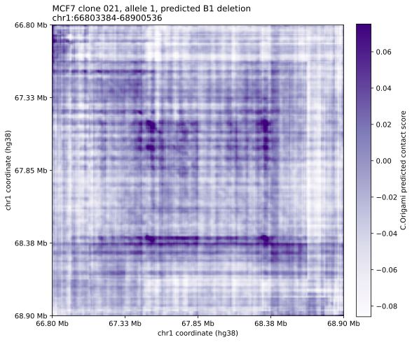

**Deletion − WT**


**Deletion-centred viewpoint**

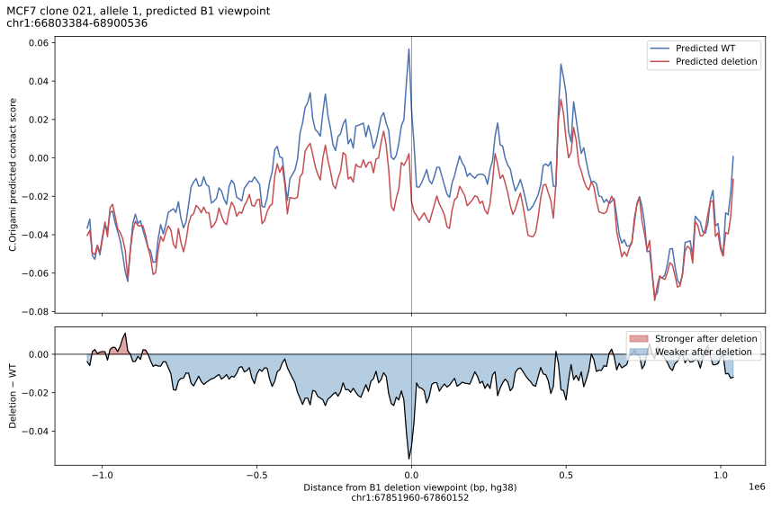

#### Clone 021, allele 2

Deletion: `chr1:67850002-67854002` (hg38; 4,000 bp)

**Predicted WT**


**Predicted deletion**

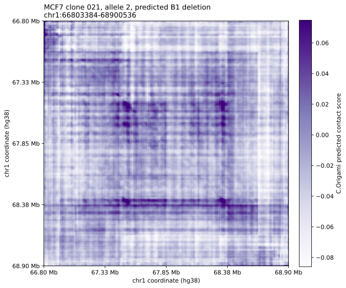

**Deletion − WT**

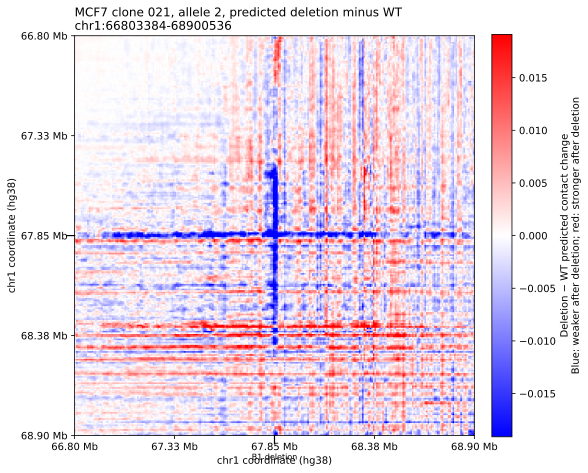

**Deletion-centred viewpoint**

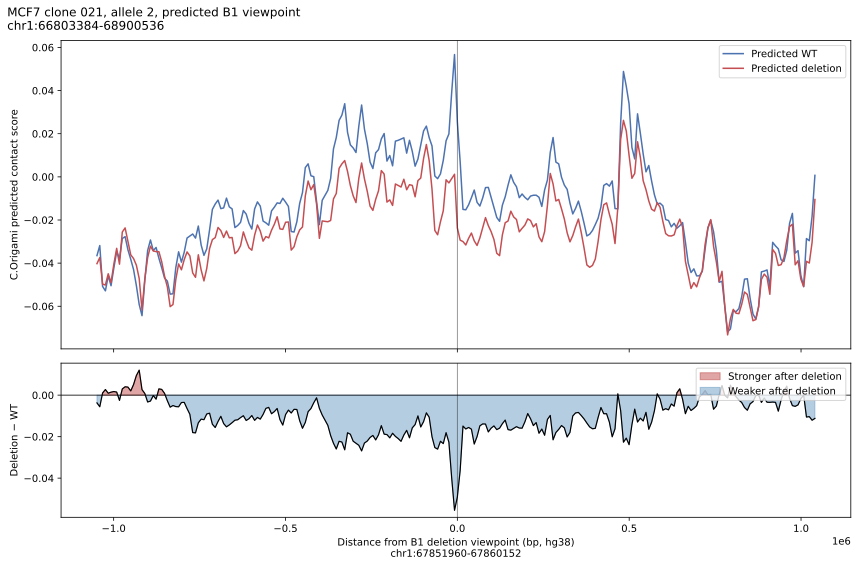

#### Clone 022, allele 1

Deletion: `chr1:67849992-67854002` (hg38; 4,010 bp)

**Predicted WT**


**Predicted deletion**

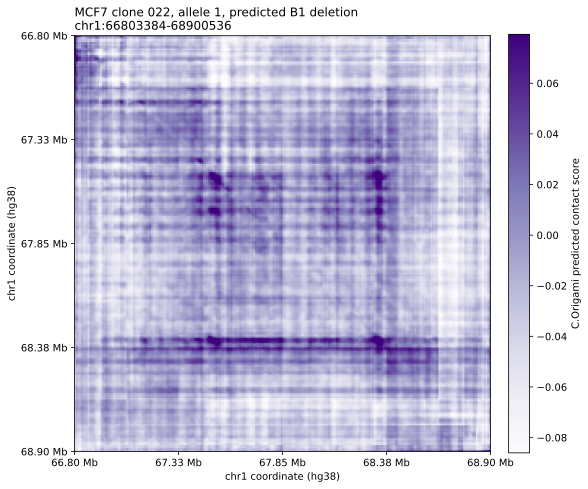

**Deletion − WT**

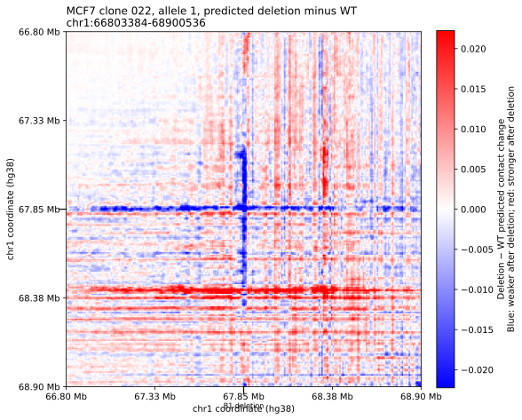

**Deletion-centred viewpoint**

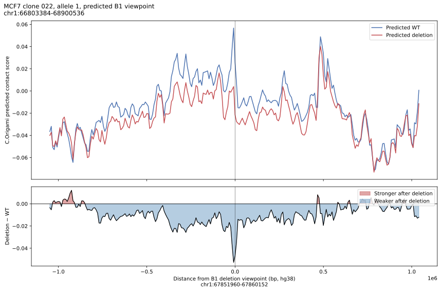

#### Clone 022, allele 2

Deletion: `chr1:67849802-67854016` (hg38; 4,214 bp)

**Predicted WT**

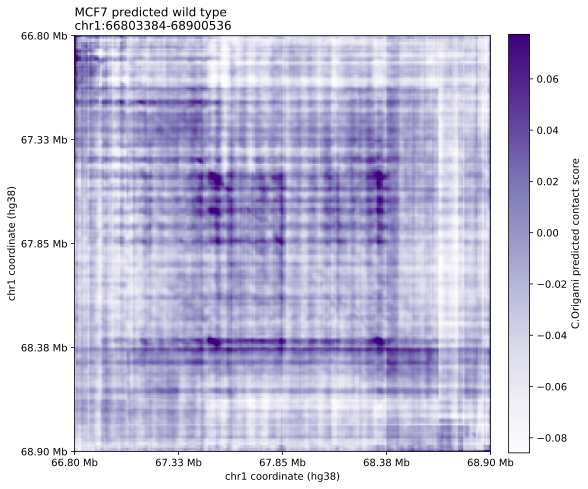

**Predicted deletion**


**Deletion − WT**

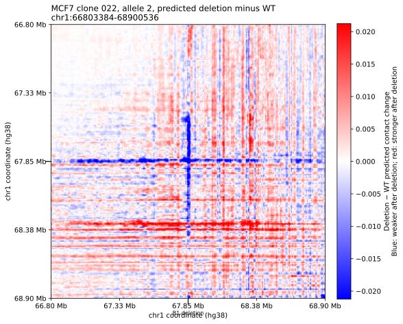

**Deletion-centred viewpoint**

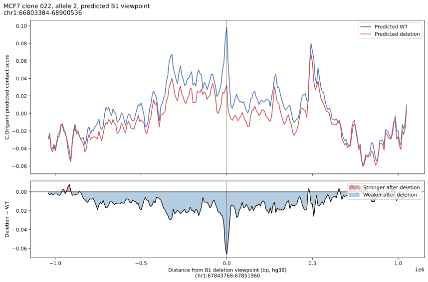

### MCF10A-conditioned predictions of the HB2 deletion alleles

These predictions apply the experimentally defined 1-7HB2 deletion coordinates within an MCF10A regulatory context. They are MCF10A-conditioned predictions, not direct HB2 predictions.

#### B1 KO clone 001, allele 1

Deletion: `chr1:67850001-67853995` (hg38; 3,994 bp)

**Predicted MCF10A WT**


**Predicted B1 deletion**

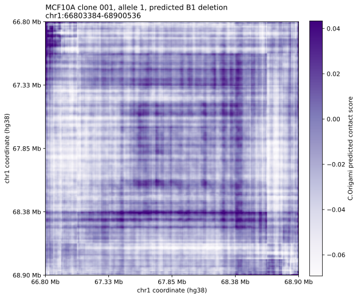

**Deletion − WT**

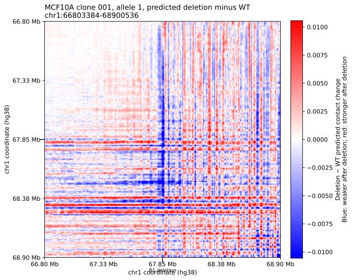

**Deletion-centred viewpoint**

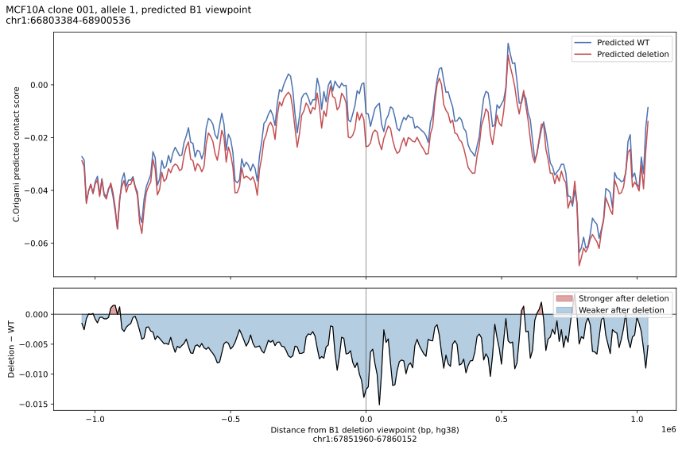

#### B1 KO clone 001, allele 2

Deletion: `chr1:67849986-67854011` (hg38; 4,025 bp)

**Predicted MCF10A WT**

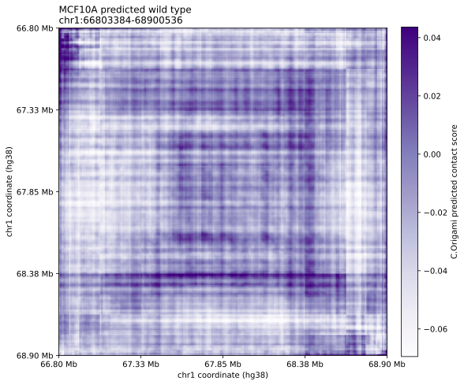

**Predicted B1 deletion**

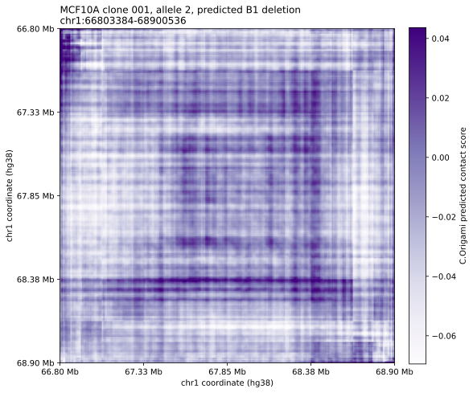

**Deletion − WT**

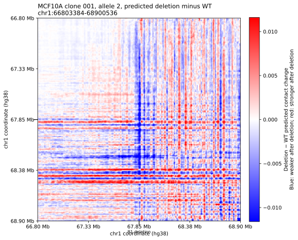

**Deletion-centred viewpoint**

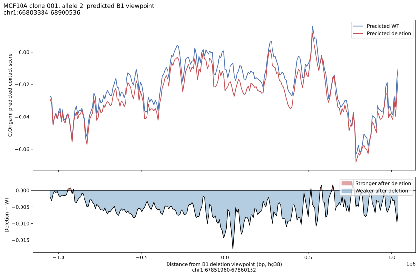

#### DIRAS3 KO clone 004, allele 1

Deletion: `chr1:68045894-68051783` (hg38; 5,889 bp)

**Predicted MCF10A WT**


**Predicted DIRAS3 deletion**


**Deletion − WT**

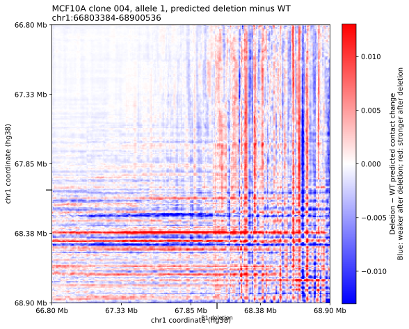

**Deletion-centred viewpoint**


#### DIRAS3 KO clone 004, allele 2

Deletion: `chr1:68045894-68051783` (hg38; 5,889 bp)

**Predicted MCF10A WT**


**Predicted DIRAS3 deletion**


**Deletion − WT**


**Deletion-centred viewpoint**

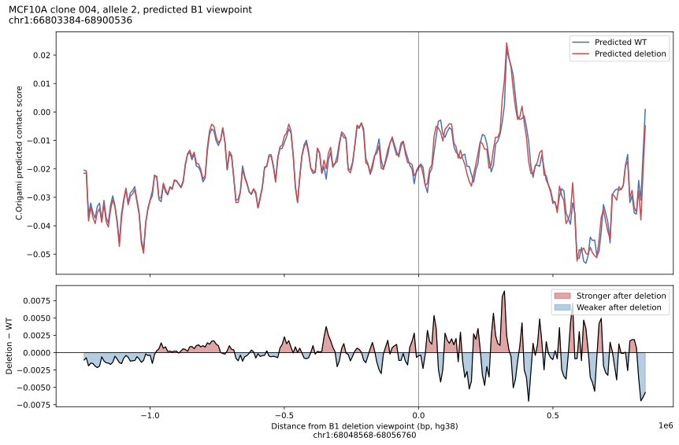

#### DIRAS3 KO clone 005, allele 1

Deletion: `chr1:68045831-68051793` (hg38; 5,962 bp)

**Predicted MCF10A WT**


**Predicted DIRAS3 deletion**

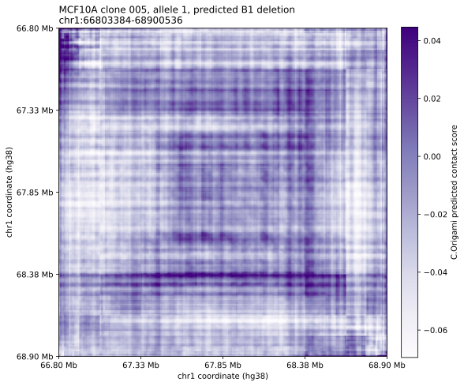

**Deletion − WT**

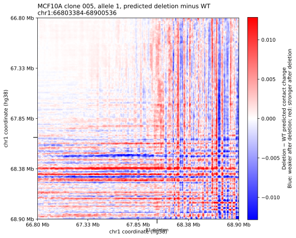

**Deletion-centred viewpoint**


#### DIRAS3 KO clone 005, allele 2

Deletion: `chr1:68045831-68051793` (hg38; 5,962 bp)

**Predicted MCF10A WT**


**Predicted DIRAS3 deletion**


**Deletion − WT**


**Deletion-centred viewpoint**

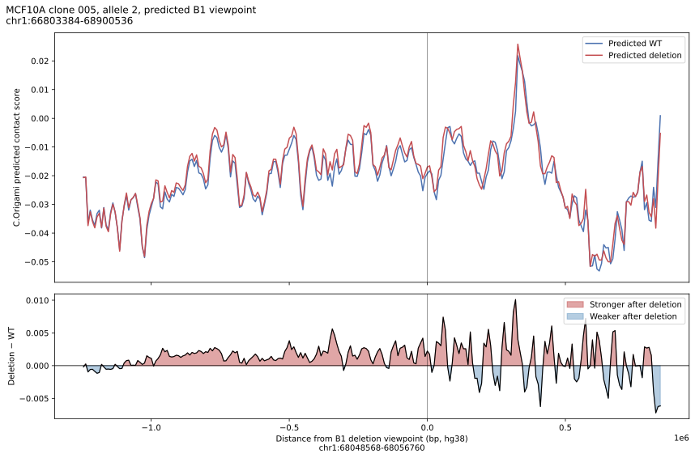

## Updating README figures

Run from the repository root after regenerating the C.Origami comparisons:

```bash
mkdir -p corigami/readme_files

rsync -av \
    corigami/results-{mcf7,mcf10a}/results/corigami/comparisons/*/*/allele*/*.svg \
    corigami/readme_files/
